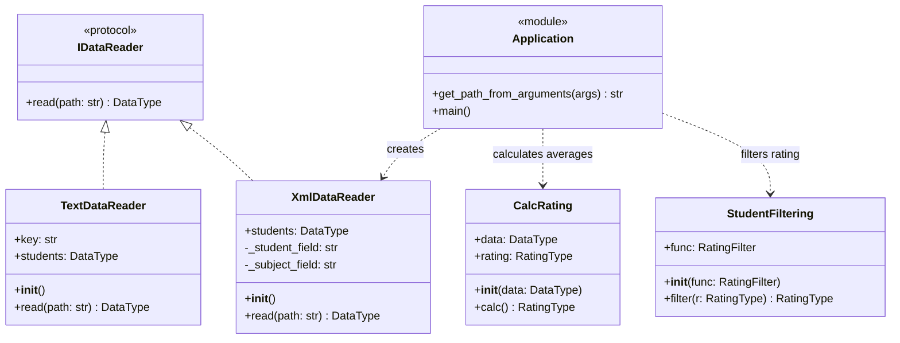

# Лабораторная работа по дисциплине «Технологии программирования»

Учебный проект `laba1`: чтение оценок студентов из XML, вычисление среднего
балла и отбор студентов, у которых этот балл не ниже 76.

## Постановка задачи

Индивидуальный вариант: входной файл имеет формат **XML**. Необходимо вычислить
средний балл каждого студента и вывести на экран тех, чей средний балл
**больше либо равен 76**. Студент с баллом ровно 76 проходит отбор. Студенты
с меньшим средним баллом в результирующий список не попадают.

В рамках работы программа:

1. Читает список студентов и их оценки.
2. Считает средний балл по дисциплинам каждого студента.
3. Оставляет студентов, удовлетворяющих порогу 76, и печатает их имена вместе
   со средним баллом.

Порог задан в консольной программе. Сам класс отбора принимает произвольный
предикат и не привязан к числу 76. Пустой набор средних баллов даёт пустой
результат отбора. Средний балл считается по всем дисциплинам студента: одна
высокая оценка не заменяет остальные.

## Описание проекта и технологии

Язык — Python 3.14. Для запуска и управления зависимостями используется `uv`,
для модульных тестов — `pytest`. Версии зависимостей зафиксированы в `uv.lock`.

```text
data/                         — примеры TXT и XML
src/
    Types.py                  — типы DataType, RatingType и RatingFilter
    IDataReader.py            — протокол чтения данных
    TextDataReader.py         — чтение исходного TXT-формата
    XmlDataReader.py          — чтение XML
    CalcRating.py             — вычисление средних баллов
    StudentFiltering.py       — отбор студентов по предикату
    main.py                   — консольная программа
test/                         — модульные тесты
docs/classes.mmd              — исходный текст UML-диаграммы
pyproject.toml                — зависимости и настройки pytest
```

Общие типы данных:

```python
DataType = dict[str, list[tuple[str, int]]]
RatingType = dict[str, float]
RatingFilter = Callable[[str, Any], bool]
```

Ключ `DataType` — имя студента, значение — список пар «дисциплина, балл».
`XmlDataReader.read()` и `TextDataReader.read()` заполняют этот тип.
`CalcRating.calc()` переводит его в `RatingType`: имя студента и средний балл.
`StudentFiltering.filter()` принимает `RatingType` и предикат `RatingFilter`
и возвращает новый словарь только с подошедшими студентами.

Консольная программа создаёт `XmlDataReader`, затем `CalcRating` и
`StudentFiltering` с условием `value >= 76`. Отбор занимает O(N) времени,
где N — число студентов в словаре средних баллов, и O(K) дополнительной
памяти, где K — число студентов, прошедших предикат. Расчёт средних занимает
O(S) времени, где S — общее число дисциплин.

## Формат XML

Корневой элемент — `<root>`. Внутри находятся элементы `<student>`
с атрибутом `name`. Каждый `<subject>` задаёт дисциплину атрибутом `name`,
а целочисленный балл — текстом элемента.

Фрагмент [data/data.xml](data/data.xml):

```xml
<?xml version="1.0" encoding="UTF-8" ?>
<root>
  <student name="Иванов Иван Иванович">
    <subject name="математика">67</subject>
    <subject name="литература">100</subject>
    <subject name="программирование">91</subject>
  </student>
</root>
```

`XmlDataReader` обходит все элементы `student` и вложенные `subject`.
Имя студента берётся из атрибута `name`, название дисциплины — из атрибута
`name` элемента `subject`, балл — из текста этого элемента и приводится
к `int`. Прочитанные пары сохраняются в поле `students` экземпляра читателя.
Повреждённый XML вызывает `ParseError`, отсутствие файла — `FileNotFoundError`.
Эти исключения консольная программа не перехватывает.

## Установка и запуск

Необходимы Python 3.14+ и установленный `uv`. Команды выполняются из корня
проекта.

```shell
uv sync --locked
uv run --locked python src/main.py -p data/data.xml
```

Программа печатает прочитанных студентов и их оценки, затем все средние баллы
и результат отбора. Для `data/data.xml` блок отбора такой:

```text
Filter >= 76:
	Иванов Иван Иванович: 80.0
	Петров Петр Петрович: 76.18181818181819
	Сидорова Анна Сергеевна: 87.18181818181819
	Смирнова Елена Владимировна: 84.0
	Попов Артем Игоревич: 78.72727272727273
	Васильева Ольга Дмитриевна: 84.18181818181819
	Федорова Мария Павловна: 85.63636363636364
	Волкова Дарья Романовна: 90.0909090909091
	Соколов Илья Кириллович: 77.0909090909091
```

Ниже порога остаются Кузнецов Дмитрий Алексеевич (75.0),
Новиков Максим Андреевич (71.72727272727273) и
Морозов Никита Викторович (74.54545454545455).

Обязательный аргумент `-p` задаёт путь к файлу. Справка:

```shell
uv run --locked python src/main.py --help
```

```text
usage: main.py [-h] -p PATH

Path to datafile

options:
  -h, --help  show this help message and exit
  -p PATH     Path to datafile
```

Код завершения 0 означает, что файл прочитан и отбор выполнен. Отсутствие
`-p` завершает программу через `SystemExit` с кодом 2.

## Тесты

```shell
uv run --locked pytest test
```

Пути импортов настроены в `pyproject.toml` (`pythonpath = ["src", "."]`),
поэтому задавать `PYTHONPATH` вручную не требуется.

| Модуль тестов                 | Проверяемые случаи                                                                 | Количество |
|-------------------------------|------------------------------------------------------------------------------------|-----------:|
| `test_XmlDataReader.py`       | чтение UTF-8 XML с двумя студентами и несколькими дисциплинами                    |          1 |
| `test_TextDataReader.py`      | чтение UTF-8 TXT с двумя студентами и несколькими дисциплинами                    |          1 |
| `test_CalcRating.py`          | сохранение входных данных, средние баллы с абсолютной точностью 0.001             |          2 |
| `test_StudentFiltering.py`    | сохранение предиката, отбор средних баллов строго больше 60                       |          2 |
| `test_main.py`                | корректный аргумент `-p`, завершение при отсутствии обязательного аргумента       |          2 |

Результат локальной проверки: **8 тестов успешно**.

В тесте среднего балла эталон такой: у Абрамова Петра Сергеевича оценки
80, 76 и 100 дают 85.3333; у Петрова Игоря Владимировича оценки 61, 80, 78
и 97 дают 79.0. В тесте отбора предикат `value > 60` оставляет 85.3333 и 61.0
и отбрасывает 59.0 и 60.0.

## Описание классов

### `Types`

Модуль объявляет три псевдонима. `DataType` — исходные оценки.
`RatingType` — словарь средних баллов. `RatingFilter` — функция двух
аргументов `(имя, балл) -> bool`. Первый аргумент позволяет отбирать
студентов по имени, второй — по значению рейтинга. Предикат консольной
программы использует только балл.

### `IDataReader`

Протокол чтения. Единственный метод — `read(path: str) -> DataType`.
Класс не хранит состояние и не содержит реализации. `TextDataReader` и
`XmlDataReader` объявлены наследниками протокола, поэтому оба отдают один
и тот же тип данных для расчёта среднего балла.

### `XmlDataReader`

Читает XML через `xml.etree.ElementTree`.

| Член              | Назначение                                              |
|-------------------|---------------------------------------------------------|
| `students`        | накопленный словарь `DataType`                          |
| `_student_field`  | имя тега студента, значение `"student"`                 |
| `_subject_field`  | имя тега дисциплины, значение `"subject"`               |
| `read`            | разбирает файл и возвращает `students`                  |

Для каждого `<student>` имя берётся из атрибута `name`. Для каждого вложенного
`<subject>` в список оценок добавляется пара из атрибута `name` и целого
числа, прочитанного из текста элемента. Другие теги внутри корня метод
`findall` не включает в результат. Как и текстовый читатель, экземпляр хранит
словарь между вызовами: следующий `read` обновляет тот же объект `students`.

### `StudentFiltering`

Отбирает студентов по предикату. Класс объявлен как неизменяемый dataclass
со слотами.

| Член     | Назначение                                                                 |
|----------|----------------------------------------------------------------------------|
| `func`   | предикат `RatingFilter`; по умолчанию пропускает любую пару               |
| `filter` | возвращает новый `RatingType` из пар, для которых предикат истинен        |

Входной словарь метод не изменяет. Порядок ключей в результате совпадает
с порядком обхода исходного рейтинга. Консольная программа передаёт
`lambda _, x: x >= 76`, поэтому граница 76 входит в результат, а значение
75.0 — нет. Предикат по умолчанию `lambda _n, _v: True` оставляет всех
студентов.

## UML-диаграмма классов

Отдельный исходник: [docs/classes.mmd](docs/classes.mmd).



## Анализ результатов и выводы

Задача индивидуального варианта выполнена: программа читает XML, считает
средний балл каждого студента и выводит тех, у кого этот балл не ниже 76.
На примере `data/data.xml` отбор оставляет девять студентов из двенадцати.
Петров Петр Петрович с баллом около 76.18 проходит порог, Кузнецов Дмитрий
Алексеевич с баллом 75.0 — нет. Граница включена в условие `>=`.

Протокол `IDataReader` задаёт единый метод `read` и общий тип `DataType`.
Расчёт среднего и отбор работают с уже прочитанными словарями и не зависят
от XML, текстового формата и печати на экран. Порог 76 находится только
в консольной программе: `StudentFiltering` можно вызвать с другим предикатом,
что и делает модульный тест с условием «строго больше 60».

Тесты проверяют сохранение входных данных, численный результат среднего балла,
состав отфильтрованного словаря и разбор аргумента `-p`. Локальный запуск
`pytest` завершился успешно для всех 8 тестов.
