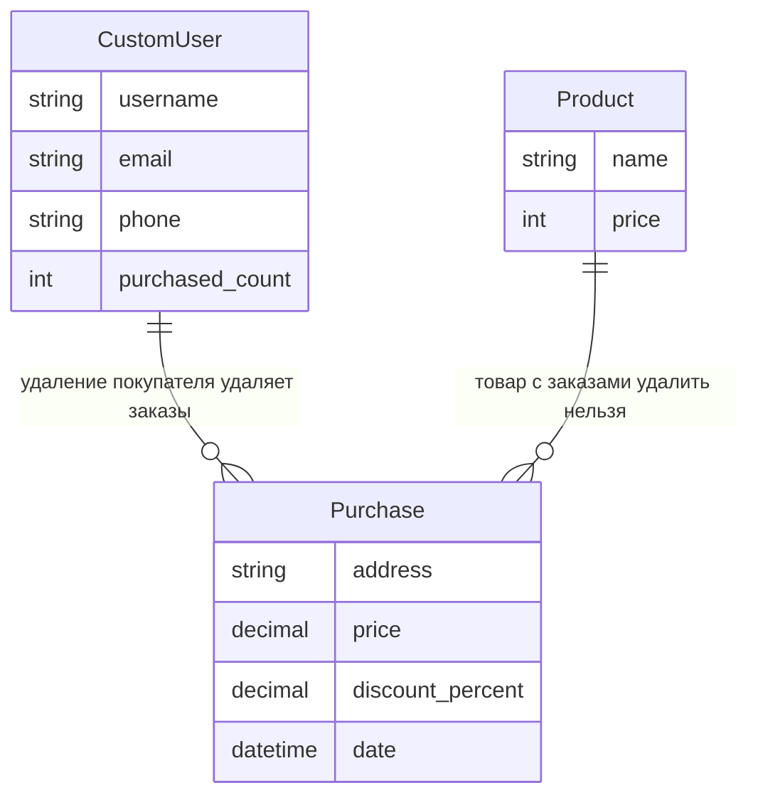
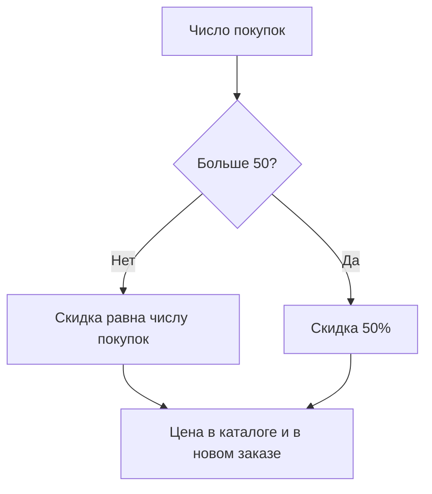
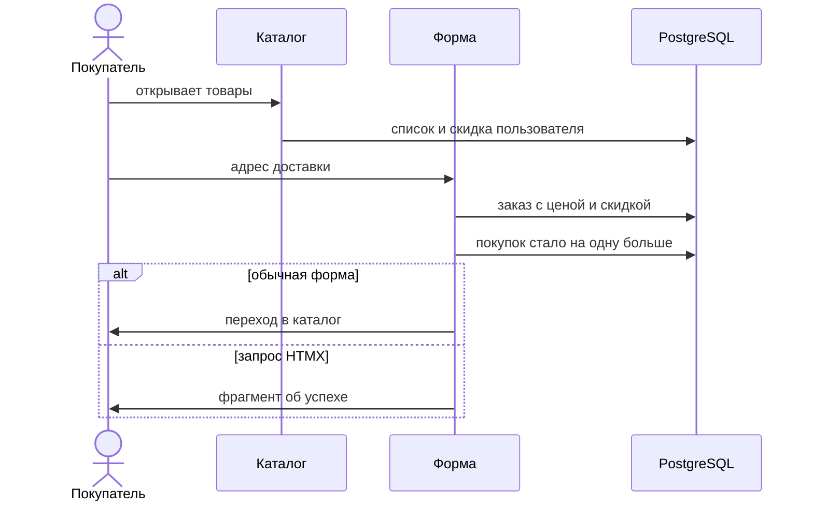

[](https://app.travis-ci.com/kpdvstu/PTLab2)

# Магазин мебели

Учебное приложение Django: каталог товаров, регистрация покупателя и персональная скидка.
Скидка растёт на 1% с каждой покупкой и останавливается на 50%. Оформляется доставка одной позиции,
в заказ записываются цена и скидка на этот момент. Пользователи и покупки хранятся в PostgreSQL.
Приложение запускается локально.

## Локальный запуск

Требуются Python 3.14+, uv и PostgreSQL. Создайте базу и заполните локальный `.env` ключами
`DJANGO_KEY`, `DEBUG`, `ROOT_URLCONF`, `NAME_DB`, `USER_DB`, `PASSWORD_DB`, `HOST_DB` и `PORT_DB`.
Для выкладки можно дополнительно задать `DATABASE_URL`.

```shell
uv sync --locked
uv run python manage.py migrate
uv run python manage.py loaddata products.yaml
uv run python manage.py runserver
```

Откройте http://127.0.0.1:8000/. В каталоге после загрузки фикстуры лежат стол, стул и табурет.
Удаление покупателя каскадно удаляет его покупки. Товар, на который уже есть покупка, удалить нельзя.
Цены в фикстуре демонстрационные.

Для управления каталогом создайте администратора:

```shell
uv run python manage.py createsuperuser
```

В `/admin/` можно менять покупателей, товары и смотреть заказы. Цена и процент скидки в покупке
только для чтения: это снимок на момент заказа.


## Устройство приложения

- `shop/models.py`: товар, покупатель и покупка. Скидка покупателя и число товаров до потолка 50%.
- `shop/services.py`: `apply_discount`, цена до копеек с округлением половины вверх.
- `shop/forms.py`: `RegisterForm` и `LoginForm`, обязательный email.
- `shop/views.py`: каталог, покупка, регистрация, вход, выход и профиль.
- `shop/templates/`: страницы магазина и фрагмент успешной покупки для HTMX.
- `shop/migrations/`: схема БД. Начальные товары лежат в `shop/fixtures/products.yaml`.
- `shop/tests/`: тесты моделей, скидки, форм, страниц, админки и адресов.



Скидка считается от числа уже совершенных покупок, а не от суммы чека.



Покупка доступна только вошедшему пользователю. Товар берётся из адреса `/buy/<id>/`.
В заказ сохраняются адрес, цена со скидкой и сам процент. Счётчик покупок увеличивается на единицу.
Обычная отправка формы возвращает в каталог. Запрос с заголовком `HX-Request` оставляет покупателя
на той же странице и подставляет фрагмент «Покупка оформлена».



Следующая покупка уже идёт с новой скидкой. Старый заказ хранит прежний процент и прежнюю цену.


## Тестирование

```shell
uv run python manage.py test --noinput
uv run python manage.py makemigrations --check --dry-run
```

Тесты приложения:

| Файл и класс | Что проверяется | Работа с базой |
| --- | --- | --- |
| `shop/tests/test_services.py` — `ApplyDiscountTests` | Нулевая и пустая скидка, 10% и 100%, округление до копеек. Для цены 999 и скидки 10% результат 899,10, а не 900. | Расчёт в памяти, без тестовой БД. |
| `shop/tests/test_urls.py` — `ShopUrlTests` | Адреса каталога, покупки, регистрации, входа, выхода, профиля и админки. | Проверка маршрутов, без тестовой БД. |
| `shop/tests/test_models.py` — `ProductModelTest`, `CustomUserModelTest`, `PurchaseModelTest` | Строковое представление, потолок скидки 50%, порядок заказов по дате, каскадное удаление покупателя и запрет удаления товара с покупками. | Тестовая БД Django. |
| `shop/tests/test_forms.py` — `RegisterFormTests`, `LoginFormTests` | Обязательный email, необязательный телефон, пароль, повтор логина и неверные данные. | Тестовая БД Django. |
| `shop/tests/test_views.py` — `IndexViewTests`, `AuthViewTests`, `PurchaseViewTests` | Каталог со скидкой и без неё, регистрация, вход и выход, покупка, фрагмент HTMX, пустой адрес, чужие заказы в профиле. | Тестовая БД Django и тестовый клиент. |
| `shop/tests/test_admin.py` — `AdminRegistrationTests`, `AdminAccessTests` | Регистрация моделей в админке и доступ: гость и покупатель не входят, сотрудник открывает списки. | Тестовая БД Django и тестовый клиент. |


## Результаты и выводы

Тесты скидки и адресов проверяют чистый расчёт и маршруты, не поднимая тестовую базу.
Остальные тесты проходят через тестовую БД Django и HTTP-клиент.

Вместе они фиксируют правила магазина. Скидка не поднимается выше 50%, а в каталоге цена считается
до копеек. В заказ попадает товар из адреса и снимок цены: следующая покупка может получить уже
другой процент, старая запись при этом не меняется. Покупатель не видит чужие заказы.
Пустой адрес и отсутствующий товар покупку не создают. Удаление покупателя забирает его заказы,
а товар с заказами остаётся в каталоге.
